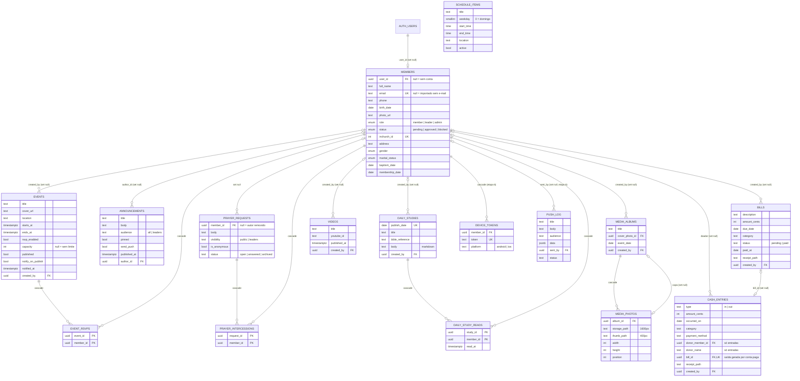

# Modelo de dados

Visão geral das tabelas e relacionamentos do Supabase. **A fonte da verdade é a skill [`app-igreja`](../.claude/skills/app-igreja/SKILL.md), seção 7** (colunas, RLS, triggers); este diagrama é um resumo para consulta e para mostrar à cliente. Ao mudar o modelo na skill, atualize aqui também.

Todas as tabelas têm `id uuid` (exceto as de chave composta), `created_at` e `updated_at`, omitidos no diagrama.

## Por área

| Área | Tabelas | Quem escreve | Quem lê |
|---|---|---|---|
| Membros | `members` | o próprio (perfil), admin (tudo) | o próprio + leader/admin; members leem nome/foto e aniversário por RPC |
| Agenda | `schedule_items`, `events`, `event_rsvps` | admin (fixos), leader/admin (eventos), approved (RSVP próprio) | approved (total de confirmados por RPC) |
| Comunicados | `announcements` | leader/admin | approved, por `audience` |
| Oração | `prayer_requests`, `prayer_intercessions` | approved | mural por RPC (anônimos ocultos), leader/admin tudo |
| Estudo diário | `daily_studies`, `daily_study_reads` | leader/admin (estudos), approved (leitura própria) | approved (só até hoje em São Paulo) |
| Mídias | `media_albums`, `media_photos`, `videos` | leader/admin | approved |
| Financeiro | `bills`, `cash_entries` | admin | admin |
| Notificações (etapa 6) | `device_tokens`, `push_log` | o próprio (token), Edge Function (log) | o próprio, admin (log) |

## Storage

| Bucket | Acesso | Conteúdo |
|---|---|---|
| `avatars` | público; cada um escreve na própria pasta | fotos de perfil (512px) |
| `event-covers` | público; leader/admin escrevem | capas de eventos (1200px) |
| `media` | público; leader/admin escrevem | `<album_id>/<photo_id>.jpg` e `_thumb.jpg` |
| `receipts` | **privado**, só admin, URL assinada | comprovantes de contas e do caixa |

Vídeos não ficam no Storage: só o `youtube_id`.
